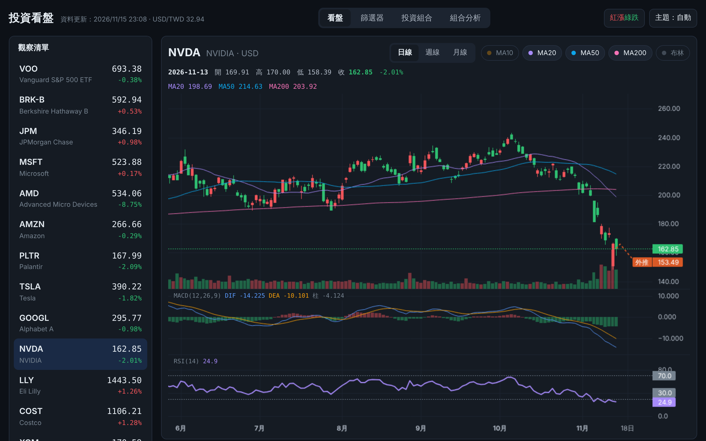
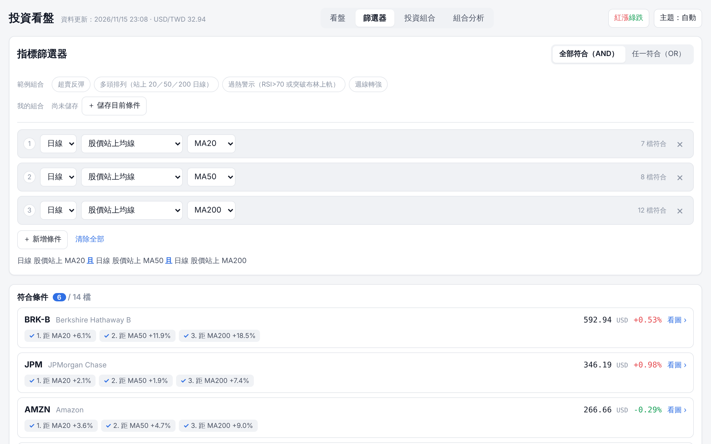
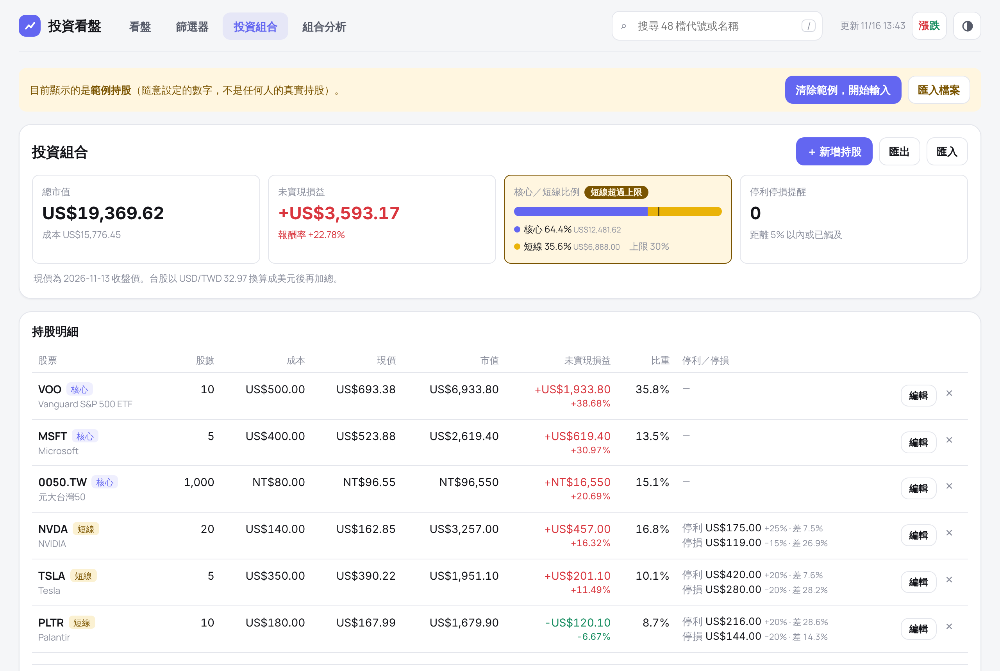
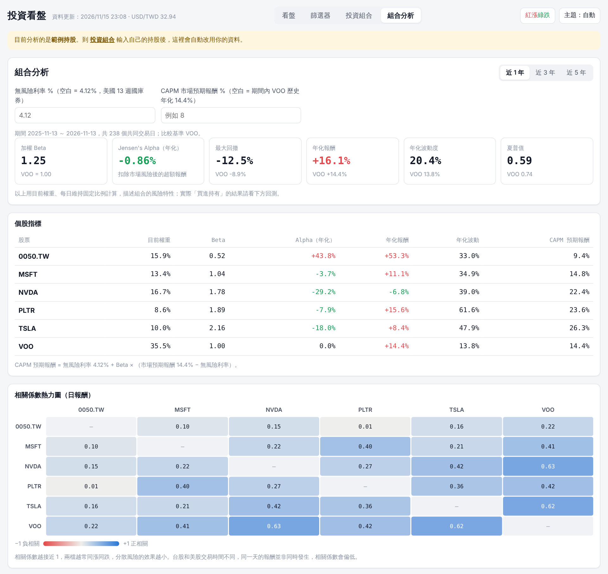
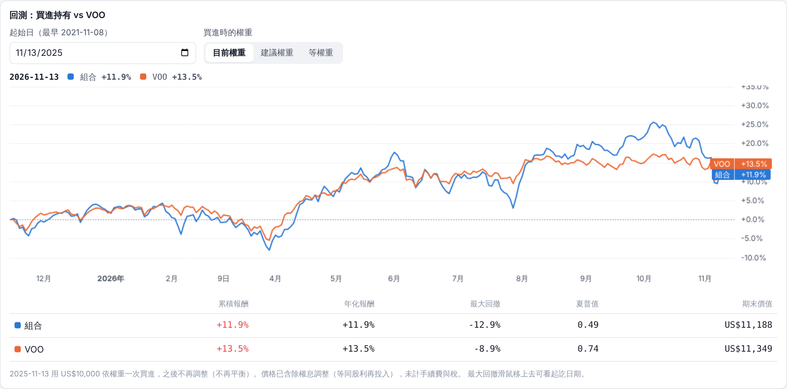
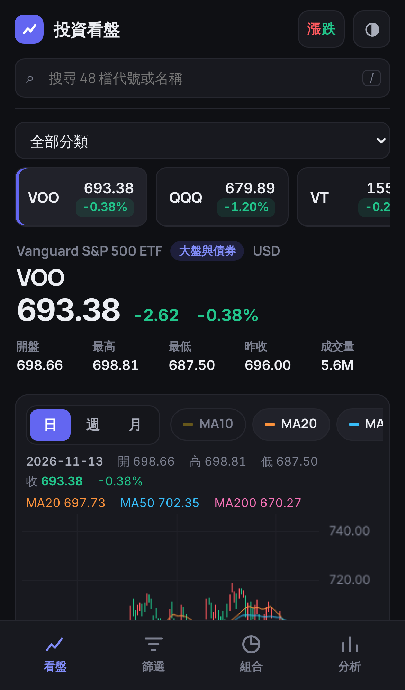

# 📈 投資看盤（Stock Dashboard）

[](https://github.com/b1343067/stock-dashboard/actions/workflows/ci.yml)
[](https://github.com/b1343067/stock-dashboard/actions/workflows/update-data.yml)

**🔗 線上展示：<https://stock-dashboard-peach-sigma.vercel.app/>**

個人投資看盤網站，同時也是我的求職作品集。
每天由 GitHub Actions 自動抓取股價、預先算好技術指標存成 JSON，網站部署在 Vercel，是純靜態網頁，不需要後端伺服器。
功能涵蓋 K 線看盤、指標篩選器、投資組合管理、組合分析（Beta／Alpha／夏普最佳化／回測），桌機與手機都能使用。

> **免責聲明：本網站僅供學習參考，非投資建議。**



| 指標篩選器 | 投資組合（範例持股） |
| --- | --- |
|  |  |
| **組合分析** | **回測 vs VOO** |
|  |  |

<p align="center"></p>

## 技術亮點

- **零後端、零成本**：GitHub Actions 每天抓資料並預先計算指標，前端只讀靜態 JSON；Vercel 免費方案部署。
- **資料管線有防護**：單檔失敗保留前一天的檔案、原子寫檔不會產生半個檔案、全部失敗不覆蓋任何資料；網頁偵測資料過期會提醒。
- **計算正確性有驗證**：
  - 100 項單元測試（Vitest），涵蓋指標、篩選條件、損益與換匯、Beta／Alpha、最佳化、回測、觀察清單分組，以及用真實資料做的「VOO 對自己 Beta = 1」自我檢查
  - Python 端以參考實作比對 Wilder RSI；組合分析的 Beta、Alpha、最大回撤另外用 numpy 交叉驗證，結果一致
  - 回測與趨勢外推的準確度測試都確認「不偷看未來資料」
- **端對端測試**：Playwright 用真的瀏覽器跑 17 項完整使用流程（桌機＋手機），包含「首頁只載入需要的資料」，包含資料讀取失敗、匯入壞檔案等異常情況；每次推送由 CI 自動執行。
- **金融細節處理**：台股先用「當天的歷史匯率」換成美元再計算、台美交易日對齊、預測日期跳過週末與美股休市日、價格含除權息調整。
- **誠實呈現**：「短期趨勢外推」附上和「明天價格 = 今天價格」比較的歷史準確度，外推比較差時直接寫出來。
- **隱私**：儲存庫公開，但個人持股只存在使用者自己的瀏覽器（localStorage），可匯出匯入備份。
- **效能**：按頁面分割程式碼，圖表套件只在需要時載入；首頁主程式約 74KB（gzip）。
- **設計**：紫藍主色、深淺色自動切換；K 線預設只顯示均線，MACD／RSI 按「＋」才展開；指標狀態用白話卡片呈現；手機版有底部導覽列；按 `/` 快速搜尋股票。
- **可及性**：顏色依資料視覺化指引挑選並驗證色盲可辨識；數值都有文字標示，不只靠顏色；支援深色模式、紅漲綠跌／綠漲紅跌切換。

## 功能（目前進度）

| 階段 | 內容 | 狀態 |
| --- | --- | --- |
| 第一階段 | 資料管線、K 線圖（日／週／月）、均線、布林通道、MACD、RSI | ✅ 完成 |
| 第二階段 | 指標篩選器（自訂條件、AND／OR、儲存組合） | ✅ 完成 |
| 第三階段 | 投資組合（持股存在瀏覽器、停利停損提醒、匯出匯入） | ✅ 完成 |
| 第四階段 | 組合分析（Beta、Alpha、最大回撤、相關係數、夏普最佳化、回測） | ✅ 完成 |
| 加碼 | 市場總覽首頁、價格提醒 | ✅ 完成 |
| 加碼 A | 多檔走勢比較、效率前緣圖、加到手機主畫面（PWA） | ✅ 完成 |
| 加碼 B | K 線畫圖工具（趨勢線、水平線）、基本面資料（本益比、殖利率、52 週高低） | ✅ 完成 |
| 加碼 C | 交易紀錄制投資組合（已實現損益、股利、XIRR）、英文版 | ✅ 完成 |

第一階段的畫面：
- 觀察清單：49 檔，分成大盤與債券、產業 ETF、科技、金融、醫療、消費、能源與工業、汽車、台股 9 類（清單在 `config/watchlist.json`，可以自己增減，見「[新增或刪除股票](#新增或刪除股票)」）
- 側邊欄依分類分組（可收合）並有搜尋框；手機版用分類下拉選單
- 只在點選某檔股票時才下載它的資料，首頁只載入總表和目前那一檔
- K 線圖可以切換日線／週線／月線，可以疊加 MA10／20／50／200 和布林通道，下方有 MACD 和 RSI
- 指標摘要卡片：RSI 區間、MACD 多空、布林 %B、股價和均線的相對位置
- 支援紅漲綠跌／綠漲紅跌切換、深色模式、手機版
- 網址會記住目前的股票和週期，例如 `/#/NVDA/weekly`

市場總覽（首頁 `/`）：
- 大盤指標卡（VOO、QQQ、VT、0050、BND、GLD）附 30 天走勢
- 漲跌家數、漲幅／跌幅前 5 名、各分類平均漲跌、類股熱力圖（點格子看 K 線）
- 可切換「今日／近 30 天」；只用總表資料，首頁不下載任何個股檔案

走勢比較（看盤頁「📈 比較」、市場總覽「比較走勢」，網址 `/#/compare/NVDA,AMD`）：
- 最多 4 檔，從同一天起算累積報酬 %（1 個月～5 年），附報酬、年化波動、最大回撤表格；網址可以直接分享

K 線畫圖工具（看盤頁 K 線上方）：
- 「╱ 趨勢線」點兩下、「— 水平線」點一下（支撐／壓力），趨勢線會自動延伸到最新一根，方便看現在價格在線的上方或下方
- 「↶ 復原」刪最後一條、「清除」刪全部；按 Esc 取消
- 畫的線存在這個瀏覽器，每檔股票、每個週期各自一份（日線的日期在週線上對不上，所以分開）

基本面（看盤頁「基本面」卡片、篩選器的基本面條件）：
- 52 週高低點與目前位置、近 12 個月殖利率：每天從價格資料計算，一定有
- 本益比、預估本益比、股價淨值比、市值、產業：來自 Yahoo Finance，抓不到時沿用上一次的數字並標示資料日期；ETF 沒有本益比
- 篩選器新增「本益比低於」「殖利率高於」「接近 52 週高點／低點」，和技術條件可以混用（內建範例「高殖利率且本益比合理」）

英文版（頁首「EN／中」按鈕）：
- 第一次打開時依瀏覽器語言自動選擇（中文瀏覽器 → 中文，其他 → 英文），之後記住你的選擇
- 介面文字都用 `t("中文原文")` 包起來，英文在 `src/lib/i18n-en.ts`；查不到翻譯時顯示中文，網頁不會壞
- 中文名稱的股票可在 `config/watchlist.json` 加 `"nameEn"`，英文模式就顯示英文名稱
- 單元測試會檢查每個 `t("…")` 都有英文翻譯；E2E 測試會用英文瀏覽器打開每一頁，確認沒有漏翻的中文

每日篩選通知（Discord）：
- 每天早上資料更新後，依 `config/notify.json` 的規則篩選，把符合的股票（含「🆕 今天新出現」標記與看圖連結）送到你的 Discord 頻道
- 規則格式和網站篩選器相同：在篩選器設好條件，按「📋 複製成通知規則」，貼到 `config/notify.json` 的 `rules` 裡
- 判斷直接用網站篩選器的同一套程式（`npx vite-node scripts/notify.ts`），結果和網頁一致；沒有股票符合時不送；同一天的資料只通知一次
- 設定步驟：
  1. Discord 頻道 → 編輯頻道 → 整合 → Webhook → 新增 Webhook → 複製 Webhook 網址
  2. GitHub 儲存庫 → Settings → Secrets and variables → Actions → New repository secret，名稱 `DISCORD_WEBHOOK_URL`，值貼上網址
  3. 到 Actions →「測試 Discord 通知」→ Run workflow：不重抓股價，用目前的資料馬上送一次（失敗會顯示紅色並說明原因）
- ⚠️ `config/notify.json` 是公開的，只放篩選條件；Webhook 網址一定要放在 Secrets，不可以寫進檔案

加到手機主畫面（PWA）：
- 手機瀏覽器選「加到主畫面」，就能像 App 一樣全螢幕打開
- 沒有網路時仍可打開，顯示上次載入的資料（頁首會提示離線）

價格提醒（頁首鈴鐺，或看盤頁的「＋提醒」）：
- 條件：收盤價漲到／跌到某價格、單日漲幅／跌幅達某 %、RSI 高於／低於某值
- 每次打開網站時用最新收盤資料檢查，觸發時頁首顯示通知與數字；可選「提醒一次」或「每天重複」
- 提醒只存在這個瀏覽器；只有設了 RSI 提醒才會額外下載 RSI 資料
- 靜態網站沒有後端，沒打開網站時無法推播通知

第二階段（`/#/screener`）：
- 自訂篩選條件，每個條件可選日線／週線／月線，用「全部符合（AND）」或「任一符合（OR）」組合
- 內建 4 組範例組合；自己的組合可以儲存在瀏覽器（localStorage），下次打開還在
- 每個條件旁顯示「幾檔符合」，方便調整參數
- 結果列出每個條件的判斷細節（例如「3 天前交叉」「RSI 28.5」），點一下直接看圖
- 也可以展開「不符合的股票」，看差在哪個條件

第三階段（`/#/portfolio`）：
- 自行輸入持股（代號、股數、平均成本），每檔標記「核心」或「短線」
- **持股只存在你自己的瀏覽器（localStorage）**，不會上傳；可以匯出成 JSON 檔備份、在別台電腦匯入
- 第一次打開會顯示明顯標示的「範例持股」，按「清除範例，開始輸入」就會清空
- 短線部位自動算停利、停損價（預設 ±20%，每檔可自訂），距離 5% 以內變色提醒，已觸及會用實心標籤
- 總市值、成本、未實現損益、報酬率，核心／短線比例長條圖（含上限標記），短線超過上限時提醒
- 總計可切換美元／台幣顯示；台股一律先用匯率換成美元再加總
- 設定（短線上限、預設停利停損、提醒範圍）也存在瀏覽器

第四階段（`/#/analysis`，以及看盤頁的「短期趨勢外推」）：
- 讀取投資組合頁的持股，依目前美元市值算權重，可選近 1／3／5 年分析
- 加權 Beta、Jensen's Alpha、最大回撤、年化報酬／波動、夏普值，每項都和 VOO 比較
- 個股 Beta、Alpha、CAPM 預期報酬表；相關係數熱力圖
- 夏普值最佳化（每檔 5%～45%），並排顯示目前權重與建議權重的差異
- 效率前緣圖：在權重限制內隨機模擬 2,500 組組合，畫出「同樣風險下報酬最高」的前緣線，並標出目前與建議組合
- 回測：選起始日與權重（目前／建議／等權重），買進持有後和 VOO 比較累積報酬、年化報酬、最大回撤、夏普值
- 看盤頁：短期趨勢外推（未來 5 個交易日）＋ 和「明天價格 = 今天價格」比較的歷史準確度

### 組合分析計算方式

| 項目 | 算法 |
| --- | --- |
| 報酬 | 日報酬；年化報酬 = 平均日報酬 × 252，年化波動 = 日報酬標準差 × √252 |
| 換匯 | 台股每天的價格 ÷ 當天 USD/TWD（`fx.json` 歷史匯率），換成美元後再算報酬 |
| 日期對齊 | 只用所有持股與 VOO 都有交易的日子（交集） |
| Beta | Cov(個股, VOO) ÷ Var(VOO)；加權 Beta = Σ 權重 × 個股 Beta |
| Jensen's Alpha | [平均(Rp − rf) − β × 平均(Rm − rf)] × 252 |
| 無風險利率 | 美國 13 週國庫券殖利率（`^IRX`，每日更新），可在頁面上手動覆蓋 |
| CAPM 預期報酬 | rf + β × (市場預期報酬 − rf)；市場預期報酬預設為期間內 VOO 歷史年化報酬，可手動輸入 |
| 夏普值最佳化 | 最大化 (預期報酬 − rf) ÷ 波動，限制每檔 5%～45%、總和 100%；投影梯度法，多個起點取最佳 |
| 最大回撤 | 淨值從前一個高點下跌的最大幅度 |
| 回測 | 起始日依權重一次買進，之後不再平衡（修正 #5）；價格含除權息調整，未計手續費與稅 |
| 短期趨勢外推 | 最近 20 個交易日收盤價線性回歸，往後延伸 5 個交易日（跳過週末與美股休市日） |
| 外推準確度 | 過去 250 個交易日走動式回測，只用當時以前的資料；和「明天 = 今天」比較平均誤差、勝率、方向正確率 |

上方摘要用「每日固定權重」描述組合的風險特性；實際買進持有的結果以回測為準。

### 資料正確性檢查

組合分析的數字對日期非常敏感：只要某一檔的日期錯開一天（例如時區轉換造成台股變成前一天），Beta 和相關係數就會全部偏低。為了防止這種錯誤，專案有三層檢查：

1. **自我檢查測試**（`src/lib/selfcheck.test.ts`，`npm test` 執行）：用網站上實際的 VOO 資料走完整個計算流程，**VOO 對自己的 Beta 和相關係數都必須等於 1**（加入台股一起對齊日期後也一樣），Alpha 必須等於 0。另有一個對照組：故意把日期錯開一天，確認相關係數會明顯下降，證明這個檢查抓得到錯位。同一個測試檔也逐一檢查每檔股票的日期：遞增、不重複、沒有週末。
2. **抓資料時明確轉換時區**（`scripts/data_quality.py`）：先把 yfinance 的時間換成交易所時區（美股紐約、台股台北）再取日期，就算 yfinance 回傳 UTC 也不會差一天。
3. **寫檔前先修正、再檢查**：少量問題自動修正（高低價沒有包含開盤收盤、台股週六補班日、零星空白或 ≤ 0 的價格）；嚴重問題（重複日期、大量週末日期＝時區錯開、問題資料超過 5%）就不寫檔、保留前一天的檔案。每檔的結果與修正內容記錄在 `status.json`。

> **為什麼 BRK-B 的 Beta 只有 0.08？** 經過上面的檢查，日期對齊與計算都正確（網頁和 Python 獨立計算結果一致）。這是資料本身的結果：BRK-B 在 2026 年的日報酬和 VOO 幾乎不連動（相關係數約 0.07），但 2022 年時相關係數是 0.81、Beta 0.76；用 5 年日報酬算則 Beta 約 0.58。財經網站常見的「BRK-B Beta 約 0.8–0.9」多半是更長期間、月報酬的算法，和這裡「近 1 年日報酬」不同。

### 投資組合計算方式

| 項目 | 算法 |
| --- | --- |
| 市值 | 股數 × 最新收盤價（原幣） |
| 未實現損益 | 市值 − 股數 × 平均成本 |
| 報酬率 | 現價 ÷ 平均成本 − 1 |
| 換匯 | 台幣 ÷ USD/TWD 匯率 = 美元；**所有加總、比重都用美元計算** |
| 停利價／停損價 | 成本 × (1 + 停利%)／成本 × (1 − 停損%) |
| 距離提醒 | \|目標價 − 現價\| ÷ 現價 ≤ 5% 時提醒；現價已超過目標價為「已達停利／已觸及停損」 |
| 短線比例 | 短線市值 ÷ 總市值（美元計），超過設定上限時提醒 |

不在觀察清單的股票沒有報價，會列出但不計入總計；要追蹤的話請加到 `config/watchlist.json`。

#### 交易紀錄模式（加碼 C）

投資組合頁可以切換「直接輸入持股」／「用交易紀錄計算」。交易紀錄模式下輸入每一筆買進、賣出、股利，持股的股數與平均成本自動算出（組合分析頁也會用這些持股）。

| 項目 | 算法 |
| --- | --- |
| 平均成本 | 移動平均成本法：買進時（股數 × 價格 + 手續費）加進總成本，平均成本 = 總成本 ÷ 持有股數；賣出不改變平均成本 |
| 已實現損益 | 賣出股數 × 賣價 − 手續費／稅 − 賣出股數 × 當時平均成本 |
| 股利 | 實領金額（扣稅後），不影響成本 |
| 總損益 | 已實現 + 未實現 + 股利；總報酬 % = 總損益 ÷ 投入本金（所有買進金額＋手續費） |
| XIRR | 找出年化報酬率 r，讓 Σ 現金流 ÷ (1 + r)^(距第一筆的年數) = 0；買進為負、賣出與股利為正，目前市值當成最新收盤日拿回的錢。牛頓法求解，不收斂時改用二分法 |
| 換匯 | 每檔用原幣；整體用美元，台股每筆現金流依交易當天的歷史匯率（`fx.json`）換算，未實現與市值用最新匯率 |

賣出股數超過當時持有時會顯示警告，只以持有股數計算。交易紀錄和持股一樣只存在瀏覽器，「匯出」的檔案會一起包含。

### 篩選條件定義

「最近 N 天內」= 包含最新一根 K 棒往前共 N 根（週線為 N 週、月線為 N 個月），N 可設 1～20。

| 條件 | 判斷方式 |
| --- | --- |
| RSI 高於／低於 X | 最新一根 RSI > X ／ < X |
| RSI 從 X 以下回升 | 最近 N 根內 RSI 由 ≤ X 穿越到 > X，而且現在仍在 X 以上 |
| MACD 黃金交叉 | 最近 N 根內 DIF 由下往上穿越 DEA（前一根 DIF ≤ DEA，這一根 DIF > DEA） |
| MACD 死亡交叉 | 最近 N 根內 DIF 由上往下穿越 DEA |
| MACD 柱狀體連續縮短 | 最近連續 N 根，柱狀體絕對值都比前一根小，且沒有翻到另一邊（正負號相同） |
| 股價突破布林上／中／下軌 | 最近 N 根內收盤價由下往上穿越該軌 |
| 股價跌破布林上／中／下軌 | 最近 N 根內收盤價由上往下穿越該軌 |
| 股價站上／跌破均線 | 最新收盤價 > ／ < 該均線（MA10／20／50／200） |
| 本益比低於 X 倍 | 本益比 < X；沒有本益比（ETF、虧損中）一律不符合，避免把虧損當成便宜 |
| 殖利率高於 X% | 近 12 個月配息合計 ÷ 最新收盤 > X%（沒配息視為 0%） |
| 接近 52 週高點 X% 以內 | (1 − 收盤 ÷ 52 週最高) ≤ X%（基本面條件不分日／週／月） |
| 接近 52 週低點 X% 以內 | (收盤 ÷ 52 週最低 − 1) ≤ X% |
| 均線黃金／死亡交叉 | 最近 N 根內，短均線由下往上（黃金）／由上往下（死亡）穿越長均線，例如 MA50 穿越 MA200 |
| 成交量放大 X 倍 | 最新一根成交量 ÷ 前 20 根平均成交量（不含最新這根）≥ X |

週線、月線的最新一根可能是「還沒結束的本週／本月」，數值會隨每天更新而變動。

## 架構

```
  ┌────────────────────────┐   每天 UTC 22:00（台灣早上 6:00）
  │     GitHub Actions     │
  │  scripts/fetch_data.py │ ← 先從 data 分支取回昨天的資料（抓失敗的股票沿用）
  └──────────┬─────────────┘
             │ yfinance 分批抓 10 年日線 → 修正小問題 → 檢查 → 計算指標
             ▼
  public/data/*.json ──強制推送（只留最新一份）──► data 分支
             │
             └─► main 上的 .data-version 改一行 ──► Vercel 偵測到新 commit
                                                        │
  ┌──────────────────────────────┐                      │
  │        Vercel（靜態網站）       │ ◄────────────────────┘
  │ 建置時從 data 分支下載資料       │  Vite + React + TypeScript
  │ 瀏覽器讀取 JSON 畫圖             │  lightweight-charts
  └──────────────────────────────┘
```

**為什麼資料放在另一個分支？** 資料每天更新、幾乎每個檔案都會變（約 12MB），如果每天 commit 到 `main`，儲存庫每天會長大好幾 MB，一年可能超過 1GB。現在 `data` 分支每次更新都覆蓋成只有一個 commit，大小不會累積；`main` 只放程式碼，每天只多一個改了一行的小 commit（用來觸發 Vercel 重新部署）。

**怎麼知道哪幾檔今天沒更新？** 看 [`data/status.json`](https://stock-dashboard-peach-sigma.vercel.app/data/status.json)：每一檔的結果、失敗原因、自動修正了什麼都在裡面，不用登入 GitHub。

**為什麼預先算好指標？** 網頁打開時不用即時計算，也不用呼叫外部 API，速度快、免費、不會被 Yahoo 擋。

**抓不到資料怎麼辦？**
- 某一檔失敗：重試 3 次，還是失敗就保留前一天的檔案，其他股票照常更新
- 資料有小錯誤：自動修正後照常更新；有嚴重錯誤：保留前一天的檔案（原因寫在 `status.json`）
- 匯率失敗：沿用上一次的匯率
- 全部失敗：不修改任何檔案，Actions 會顯示紅色 ❌ 通知你
- 寫檔時先寫暫存檔再換名，不會產生寫到一半的壞檔案
- 前端讀取失敗時只會在該區塊顯示錯誤訊息，整個網頁不會壞掉

## 資料夾說明

```
.
├── .github/workflows/
│   ├── update-data.yml      # 每日自動更新資料的排程（GitHub Actions）
│   └── ci.yml               # 推送時自動跑測試與建置
├── config/
│   └── watchlist.json       # ★ 觀察清單（依分類分組）：新增／刪除股票只要改這個檔案
├── docs/screenshots/        # README 用的截圖（範例持股，不含真實資料）
├── e2e/                     # Playwright 瀏覽器端對端測試（npm run test:e2e）
├── public/                  # 原封不動複製到網站上的檔案
│   ├── data/                # ★ 股價與指標資料（由 Python 腳本產生，不要手動改）
│   │   ├── index.json       #   總表：股票清單、最新價格、匯率、無風險利率、更新時間
│   │   ├── fx.json          #   USD/TWD 歷史匯率（組合分析換算台股報酬用）
│   │   ├── screener.json    #   篩選器用：每檔各週期最近 30 根的指標（約 44KB）
│   │   └── <代號>.json      #   每檔股票一個檔案，含日／週／月線與指標
│   ├── sw.js                # Service Worker（離線瀏覽；網路優先／快取優先策略）
│   ├── manifest.webmanifest # 加到主畫面的設定
│   ├── icons/               # App 圖示
│   └── favicon.svg
├── reference/               # 舊的課堂作業（只供參考，不會部署）
├── scripts/                 # Python 資料處理
│   ├── indicators.py        #   技術指標計算（核心邏輯）
│   ├── data_io.py           #   讀設定檔、讀寫 JSON、重建 index.json 與 screener.json
│   ├── data_quality.py      #   日期轉成交易所時區、寫檔前的資料檢查
│   ├── fetch_data.py        #   抓真實資料（GitHub Actions 執行）
│   ├── generate_sample_data.py  # 產生隨機範例資料（不需網路）
│   ├── notify.ts            #   每日篩選通知（Actions 執行，送到 Discord）
│   ├── fundamentals.py      #   基本面：52 週高低、殖利率、本益比等（抓不到沿用上次）
│   ├── test_indicators.py   #   指標計算的自我檢查
│   └── requirements.txt     #   Python 套件清單
├── src/                     # 前端程式（React + TypeScript）
│   ├── main.tsx             #   進入點
│   ├── App.tsx              #   最外層：頁首分頁、切換頁面、頁尾
│   ├── pages/               #   頁面
│   │   ├── MarketPage.tsx   #     市場總覽（首頁）
│   │   ├── ChartPage.tsx    #     看盤頁（觀察清單＋K 線圖）
│   │   ├── ComparePage.tsx  #     多檔走勢比較
│   │   ├── ScreenerPage.tsx #     指標篩選器
│   │   ├── PortfolioPage.tsx#     投資組合
│   │   └── AnalysisPage.tsx #     組合分析
│   ├── styles.css           #   全站樣式與深淺色主題
│   ├── components/          #   畫面元件
│   │   ├── StockChart.tsx   #     K 線圖（lightweight-charts）
│   │   ├── ChartToolbar.tsx #     日／週／月切換、指標開關
│   │   ├── DrawingTools.tsx #     畫圖工具列（趨勢線、水平線、復原、清除）
│   │   ├── FundamentalsCard.tsx #  基本面卡片
│   │   ├── Watchlist.tsx    #     觀察清單
│   │   ├── SignalSummary.tsx#     指標摘要卡片
│   │   ├── Header.tsx / Footer.tsx / ErrorBoundary.tsx
│   │   ├── screener/        #     篩選器元件：條件列、常用組合、結果列表
│   │   ├── portfolio/       #     投資組合元件：總覽、持股表、表單、設定、交易紀錄
│   │   ├── analysis/        #     組合分析元件：相關係數熱力圖、權重比較、回測圖
│   │   └── TrendCard.tsx    #     短期趨勢外推卡片（看盤頁）
│   └── lib/                 #   非畫面的工具程式
│       ├── types.ts         #     JSON 資料格式定義
│       ├── data.ts          #     讀取 JSON
│       ├── route.ts         #     網址：#/代號/週期、#/screener、#/portfolio、#/analysis
│       ├── screener.ts      #     篩選條件判斷邏輯（純函式）
│       ├── screener.test.ts #     篩選邏輯的單元測試（npm test）
│       ├── portfolio.ts     #     投資組合計算（換匯、損益、停利停損、匯入驗證）
│       ├── portfolio.test.ts#     投資組合的單元測試
│       ├── transactions.ts  #     交易紀錄：移動平均成本、已實現損益、XIRR
│       ├── portfolioStore.ts#     從 localStorage 讀取持股（投資組合、分析頁共用）
│       ├── analytics.ts     #     組合分析：Beta、Alpha、CAPM、最佳化、回測
│       ├── trend.ts         #     短期趨勢外推、交易日、歷史準確度
│       ├── analytics.test.ts#     組合分析與趨勢外推的單元測試
│       ├── compare.ts       #     走勢比較（從起始日正規化、統計）
│       ├── drawings.ts      #     畫圖工具的資料與點擊處理
│       ├── fundamentals.ts  #     基本面卡片的計算與文字
│       ├── market.ts        #     市場總覽計算（漲跌家數、排行、分類平均、熱力圖）
│       ├── alerts.ts        #     價格提醒判斷；alertsStore.ts 共用狀態
│       ├── notify.ts        #     每日篩選通知：規則、比較昨天、組 Discord 訊息
│       ├── i18n.ts          #     多語系：t()、語言切換；i18n-en.ts 英文對照表
│       ├── format.ts        #     金額、百分比格式化
│       ├── freshness.ts     #     資料過期檢查（落後 3 個平日以上提醒）
│       ├── watchlist.ts     #     觀察清單分組、搜尋、分類篩選
│       ├── selfcheck.test.ts#     自我檢查：VOO 對自己 Beta = 1、日期對齊
│       ├── storage.ts       #     localStorage 安全讀寫
│       └── theme.ts         #     從 CSS 讀取圖表顏色
├── CLAUDE.md                # 給 AI 助手看的專案規則
├── index.html / vite.config.ts / tsconfig.json / package.json
├── playwright.config.ts     # E2E 測試設定（桌機＋手機）
└── vercel.json              # Vercel 部署設定
```

## 資料格式

`public/data/<代號>.json`（欄位導向，每個陣列長度相同，第 i 筆對應 `time[i]`）：

```jsonc
{
  "symbol": "NVDA", "name": "NVIDIA", "currency": "USD",
  "sample": false,              // true = 隨機範例資料
  "lastDate": "2026-11-13", "lastClose": 123.45, "changePct": 1.23,
  "daily":   { "time": [...], "open": [...], "high": [...], "low": [...], "close": [...], "volume": [...],
               "ma10": [...], "ma20": [...], "ma50": [...], "ma200": [...],
               "rsi": [...], "macd": [...], "signal": [...], "hist": [...],
               "bbUpper": [...], "bbMiddle": [...], "bbLower": [...] },
  "weekly":  { ...同上 },
  "monthly": { ...同上 },
  "fundamentals": {             // 基本面（舊檔可能沒有）
    "high52w": 152.89, "low52w": 86.62,          // 52 週高低（調整後價格）
    "dividendYield": 0.03, "dividendTtm": 0.04,   // 近 12 個月殖利率（%）與每股配息
    "pe": 45.3, "forwardPe": 28.1, "pb": 38.2,    // 沒有時為 null（例如 ETF）
    "marketCap": 3950000000000, "sector": "Technology", "industry": "Semiconductors",
    "quoteType": "EQUITY", "infoDate": "2026-11-13"  // 本益比等數字的資料日期
  }
}
```

- 價格四捨五入到小數 2 位；MACD 因為數值小，保留 4 位
- 資料不足（例如前 199 天沒有 MA200）時為 `null`
- 日線保留最近約 5 年（1260 個交易日）；週、月線保留 10 年
- 台股（`.TW`）以台幣計價，`currency` 為 `TWD`；匯率在 `index.json` 的 `fx.USDTWD`

## 指標計算方式

| 指標 | 算法 |
| --- | --- |
| 均線 MA | 收盤價的簡單移動平均（10、20、50、200 期） |
| RSI(14) | **Wilder 平滑法**：漲跌幅各自做 `ewm(alpha=1/14, adjust=False)`，和一般看盤軟體一致 |
| MACD(12,26,9) | DIF = EMA12 − EMA26；DEA = DIF 的 EMA9；柱狀體 = DIF − DEA |
| 布林通道 | 中軌 = 20 期均線；上下軌 = 中軌 ± 2 × 20 期標準差（母體標準差） |
| 週線／月線 | 由日線整理：開 = 第一天開盤、高 = 最高、低 = 最低、收 = 最後一天收盤、量 = 加總；日期為該期間最後一個交易日 |

週線、月線的指標是用「週 K、月 K 的收盤價」重新計算，例如週線 MA20 = 20 週均線。

## 相對於舊作業的修正

舊作業 `reference/old_streamlit_app.py` 的問題與修正方式：

1. ✅ RSI 改用 Wilder 平滑法（第一階段已完成）
2. ✅ 新增布林通道（20 日、2 倍標準差）（第一階段已完成）
3. ✅ 台股先用匯率換成美元再加總市值（第三階段）
4. ✅「AI 預測」改名為「短期趨勢外推」，只算交易日，並與「明天價格 = 今天價格」比較歷史準確度（第四階段）
5. ✅ 回測改成從使用者選的起始日，用設定權重買進持有（不再用今天的權重回推）（第四階段）
6. ✅ 預設持倉改成範例資料（第三階段）

## 本機開發

需要 Node.js 20 以上、Python 3.11 以上。

```bash
npm install          # 安裝前端套件
npm run data:pull    # 從 data 分支下載最新的股價資料到 public/data（需要網路）
npm run dev          # 開發模式，打開 http://localhost:5173
npm run build        # 正式打包到 dist/
npm test             # 執行單元測試（vitest）
npm run test:e2e     # 執行瀏覽器端對端測試（Playwright，要先 npm run build）
```

Python 資料腳本：

```bash
pip install -r scripts/requirements.txt
python scripts/test_indicators.py        # 檢查指標計算
python scripts/fetch_data.py             # 抓真實資料（需要能連到 Yahoo Finance）
python scripts/generate_sample_data.py   # 產生隨機範例資料（會覆蓋本機的 public/data；沒網路時用）
```

## 部署步驟

### 1. Vercel

1. 登入 [vercel.com](https://vercel.com)，按 **Add New… → Project**，選擇這個 GitHub 儲存庫 → **Import**
2. 設定（`vercel.json` 已經寫好，通常會自動帶入，確認一下即可）：
   - **Framework Preset**：Vite
   - **Root Directory**：`./`（不用改）
   - **Build Command**：`npm run build`
   - **Output Directory**：`dist`
   - **Install Command**：預設（`npm install`）
   - **Environment Variables**：不需要
3. 按 **Deploy**。之後每次有新的 commit（包括 Actions 每天更新的資料），Vercel 都會自動重新部署。

### 2. GitHub Actions 權限

儲存庫 **Settings → Actions → General**：
- **Actions permissions**：Allow all actions and reusable workflows
- **Workflow permissions**：選 **Read and write permissions** → **Save**

（workflow 檔案裡也有寫 `permissions: contents: write`，但如果儲存庫或組織層級限制為唯讀，還是要改上面這個設定。）

### 3. 手動觸發一次資料更新

1. 到儲存庫的 **Actions** 分頁
2. 左側點 **更新股價資料**
3. 右邊按 **Run workflow** → 選分支（main）→ **Run workflow**
4. 約 1～3 分鐘後完成，會多一個 `chore(data): 每日資料更新` 的 commit，Vercel 接著自動部署，網站上的「範例資料」提示就會消失

> 💡 修改 `config/watchlist.json`、`scripts/` 或這個 workflow 檔並推到 `main` 時，也會自動執行一次。

> ⚠️ 排程（schedule）只會在**預設分支**上執行；另外 GitHub 規定儲存庫 60 天沒有任何活動時會自動停用排程，到時候到 Actions 頁面重新啟用即可。

## 新增或刪除股票

觀察清單只在 **`config/watchlist.json`** 一個檔案，不用改任何程式碼。

### 1. 編輯設定檔

可以直接在 GitHub 網頁上改：打開 `config/watchlist.json` → 右上角鉛筆圖示 → 修改 → **Commit changes**（commit 到 `main`）。

檔案依分類分組，每一檔只要寫代號和名稱：

```jsonc
{
  "groups": [
    {
      "name": "科技",                                   // 分類名稱（側邊欄的分組標題）
      "tickers": [
        { "symbol": "AAPL", "name": "Apple" },
        { "symbol": "NFLX", "name": "Netflix" }          // ← 新增一行就好（注意上一行結尾要有逗號）
      ]
    },
    {
      "name": "日股",                                   // ← 新增一個分類
      "tickers": [{ "symbol": "7203.T", "name": "豐田汽車" }]
    }
  ]
}
```

| 規則 | 說明 |
| --- | --- |
| 代號格式 | 用 Yahoo Finance 的代號：美股直接寫（`AAPL`）、台股上市加 `.TW`（`2330.TW`）、上櫃加 `.TWO`、代號裡的「.」改成「-」（`BRK-B`） |
| 幣別 | 自動判斷：`.TW`／`.TWO` 是台幣，其他當美元。其他幣別的股票（例如日股）可以加 `"currency": "JPY"`，但組合分析目前只支援美元與台幣換算 |
| 分類順序 | 側邊欄和篩選器的分類順序 = 檔案裡的順序 |
| 重複代號 | 只保留第一個，Actions 紀錄會顯示警告 |
| 刪除股票 | 把那一行刪掉即可；它的舊資料檔還留在 data 分支也不影響網站 |
| 改名或換分類 | 直接改，下次資料更新後生效，不用重抓歷史資料 |

不確定代號對不對？到 [Yahoo Finance](https://finance.yahoo.com/) 搜尋，網址 `/quote/` 後面那段就是代號。

### 2. 等資料更新

改到 `config/watchlist.json` 並推到 `main` 後，「更新股價資料」Actions 會**自動執行**（也可以到 Actions 頁面手動 Run workflow）。約 3～5 分鐘後新股票就會出現在網站上。
代號打錯或 Yahoo 抓不到的股票不會出現在網站上，也不會影響其他股票；到 Actions 的執行紀錄搜尋該代號就能看到原因。

### 3. （選用）在本機先看畫面

```bash
python scripts/generate_sample_data.py --missing-only   # 只替還沒有資料的新股票產生「隨機範例資料」
npm run dev
```
範例資料只是讓你預覽版面；`public/data` 不會被 commit（資料在 data 分支），想還原成真實資料就執行 `npm run data:pull`。

### 資料更新怎麼處理幾十檔股票

- 每 10 檔一批，批次之間休息幾秒，避免被 Yahoo 限流
- 每檔失敗會自動重試 3 次（間隔 2、4、8 秒）；全部跑完後，下載失敗的再統一重試一輪
- 任何一檔失敗（抓不到、資料異常、計算出錯）都只會跳過那一檔並保留它前一天的檔案，不會中斷整個更新

## 隱私

本儲存庫是公開的，**不放任何真實持股資料**。之後的投資組合功能，持股只會存在使用者自己的瀏覽器（localStorage），匯出的 JSON 檔也已列入 `.gitignore`。

## 技術

Vite · React 19 · TypeScript · Vitest · lightweight-charts v5 · Python · pandas · yfinance · GitHub Actions · Vercel
